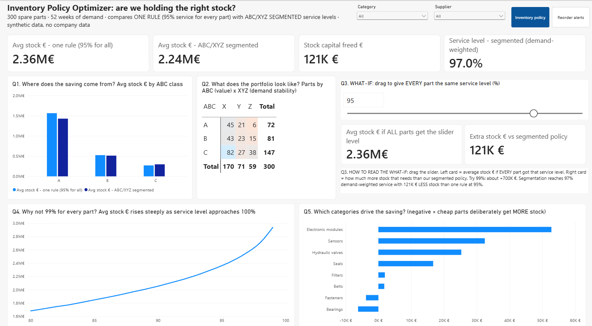
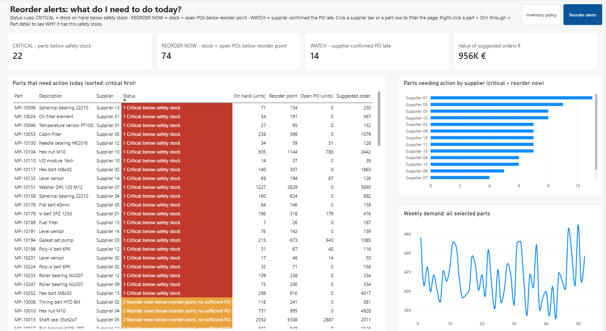

# ai-inventory-copilot

## Power BI dashboard

Built on the Excel model above (file: `Inventory-Dashboard.pbix`, synthetic data).
Three pages, each answering one planning question:

**1. Inventory policy – are we holding the right stock?**
Compares one service level for every part (95%) with ABC/XYZ-segmented service levels.
Result: about 121K € less average stock at 97% demand-weighted service.
A what-if slider shows the stock needed if every part got the same service level (e.g. 99% ≈ +700K €).

**2. Reorder alerts – what needs action today?**
22 parts below safety stock, 74 to reorder now, 14 with late supplier confirmations;
suggested orders worth about 956K €. Clicking a supplier filters the page.

**3. Part detail – why does this part have this safety stock?**
Drill-through page (right-click a part) showing segment, service level, demand variability,
safety stock, reorder point, EOQ and the suggested order.

**Power BI features used:** DAX measures, what-if parameter, drill-through,
conditional formatting, page navigation, synced slicers.
